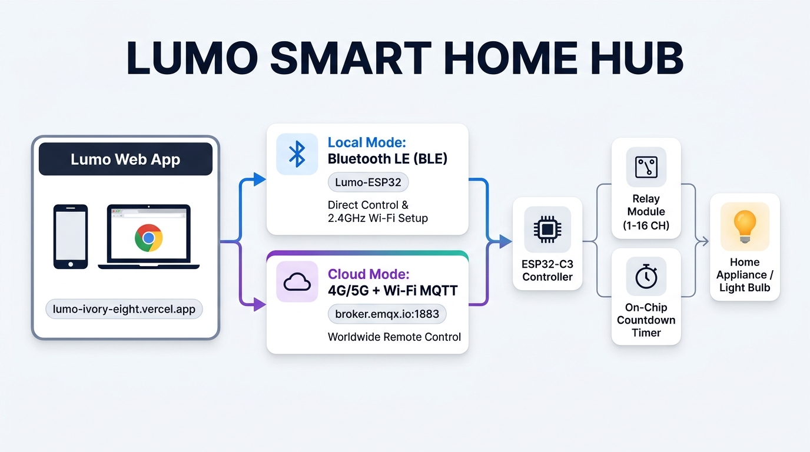
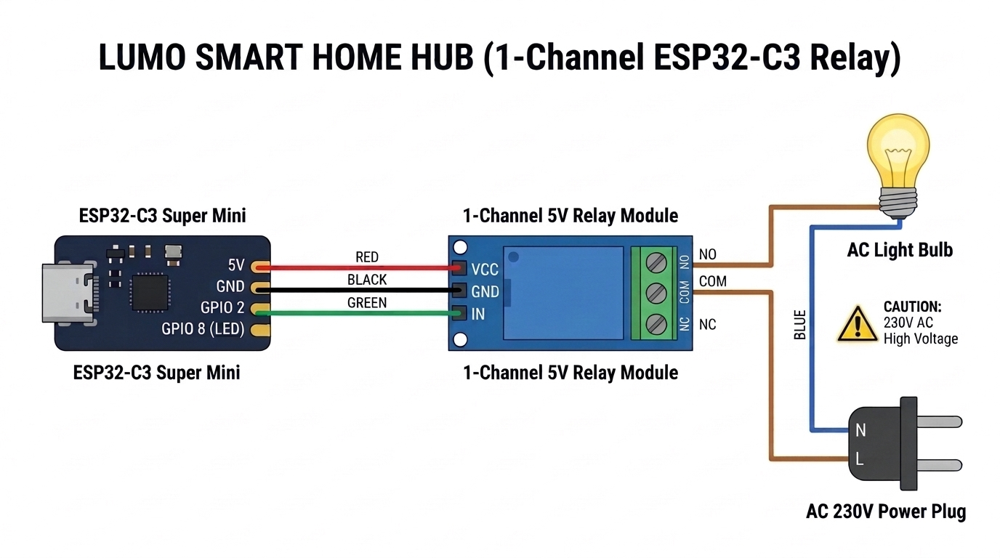

# Lumo Smart Home Hub — ESP32 Relay Controller (BLE + Wi-Fi / Cloud MQTT)

A dual-mode **Smart Home Automation Firmware** for **ESP32 / ESP32-C3 / ESP32-S3** supporting **1 to 16 relay channels** (`LUMO R1` to `LUMO R16`). Control appliances locally over **Bluetooth Low Energy (Web Bluetooth / Mobile App)** or worldwide over **Wi-Fi + Cloud MQTT** using the **Lumo Web App**.

- **Control Web App:** [https://lumo-ivory-eight.vercel.app/](https://lumo-ivory-eight.vercel.app/)
- **Firmware Repository:** [https://github.com/vistaratech/Smart-home-code-.git](https://github.com/vistaratech/Smart-home-code-.git)

---

## System Architecture



### How It Works
1. **Local Mode (Bluetooth Low Energy — `Lumo-ESP32`):**
   - Connects directly from Chrome (Web Bluetooth) or a mobile app via `https://lumo-ivory-eight.vercel.app/`.
   - Works completely offline (no internet or router required).
   - Automatically announces the configured channel count (`CONFIG:CHANNELS:<count>`) so the app adapts to 1-CH, 2-CH, 4-CH, 8-CH, or 16-CH hardware.
   - Supports **in-app non-blocking 2.4 GHz Wi-Fi scanning and provisioning** (`SCAN_WIFI` / `SET_WIFI`), storing credentials permanently in ESP32 NVS Flash (`Preferences`).
2. **Cloud Mode (Wi-Fi + Cloud MQTT — `broker.emqx.io:1883`):**
   - Once Wi-Fi credentials are saved over BLE, the ESP32 connects automatically to `broker.emqx.io` on port `1883`.
   - Enables worldwide remote control from **4G/5G mobile data** or any remote network without router port forwarding.
   - Non-blocking loop keeps BLE responsive even when Wi-Fi is disconnected.
3. **On-Chip Hardware Countdown Timers:**
   - Countdown timers run directly inside the ESP32 (`millis()`), so scheduled auto-OFF finishes reliably even if your phone disconnects or internet drops.

---

## Wiring & Circuit Diagram



### Components Needed
- **Microcontroller:** ESP32-C3 Super Mini (or ESP32 DevKit / ESP32-S3)
- **Relay Module:** 1-Channel (or 2 / 3 / 4 / 6 / 8 / 12 / 16-Channel) 5V Relay Module (**Active LOW**)
- **Power Supply:** 5V USB Type-C cable & adapter
- **Wiring:** Female-to-Female / Male-to-Female jumper wires
- **AC Test Load:** Bulb, bulb holder, 2-pin AC plug wire, and insulation tape

### 1-Channel Pin Connections (`NUM_CHANNELS = 1`)

| Relay Module Pin | ESP32-C3 / ESP32 Pin | Purpose |
|---|---|---|
| **VCC** | **5V (VIN)** | Relay coil power (5V recommended for reliable switching) |
| **GND** | **GND** | Common ground |
| **IN / Signal** | **GPIO 2** | Relay 1 control signal (`RELAY_PINS[0]`) |
| *(On-board LED)* | **GPIO 8** | BLE connection status LED (`LED_PIN = 8`, Active LOW on ESP32-C3 Super Mini) |

> **Multi-Channel Configuration (`LUMO R1`–`LUMO R16`):**  
> Edit `#define NUM_CHANNELS 1` in `home_relay/home_relay.ino` to `1`, `2`, `3`, `4`, `6`, `8`, `12`, or `16`.  
> Default GPIO mapping (`RELAY_PINS[16]`):  
> `{2, 3, 4, 5, 12, 13, 14, 15, 18, 19, 21, 22, 23, 25, 26, 27}`  
> *(Adjust pins if your specific ESP32-C3/S3 variant exposes a different GPIO layout.)*

### AC High-Voltage Wiring (`COM` / `NO`)
- **Neutral (`N`):** Connect directly from the AC plug to one terminal of the bulb holder.
- **Live / Phase (`L`):** Cut the live wire and connect one end to Relay **`COM`** and the other end (going to the bulb) to Relay **`NO`** (Normally Open).

> [!CAUTION]
> **230V / 110V AC Mains Safety:** Always disconnect the AC power plug before touching or modifying any wires. Never touch the underside of the relay PCB while mains power is connected, and house the relay module inside an insulated enclosure before regular use.

---

## Firmware Setup & Upload Guide

### 1. Required Software & Libraries
1. Install **Arduino IDE** (or `arduino-cli`).
2. Add **ESP32 Board Support** (`esp32` by Espressif Systems) via **Boards Manager**.
3. Install **`PubSubClient`** (by Nick O'Leary) via **Library Manager** (`Tools` → `Manage Libraries`).

### 2. Open the Sketch
Open `home_relay/home_relay.ino` (or `home_control_code.ino`, which is identical).

Optional hardware flags at the top of `home_relay/home_relay.ino`:
```cpp
#define NUM_CHANNELS        1       // 1, 2, 3, 4, 6, 8, 12, or 16
const int RELAY_PINS[16]    = {2, 3, 4, 5, 12, 13, 14, 15, 18, 19, 21, 22, 23, 25, 26, 27};
const int LED_PIN           = 8;    // ESP32-C3 Super Mini on-board LED (use GPIO 2 on classic ESP32 if unused)
const bool ACTIVE_LOW       = true; // Most relay boards: LOW = ON, HIGH = OFF
const bool LED_ACTIVE_LOW   = true; // ESP32-C3 on-board LED is active LOW
```

### 3. Board Settings (Important!)
Because the firmware includes both **Wi-Fi** and **Bluedroid BLE**, the compiled binary is ~1.25 MB and exceeds the default 1.2 MB app partition. Select these settings in **Tools**:

| Setting | ESP32-C3 Super Mini | Classic ESP32 DevKit |
|---|---|---|
| **Board** | `ESP32C3 Dev Module` | `ESP32 Dev Module` |
| **Partition Scheme** | **`Huge APP (3MB No OTA/1MB SPIFFS)`** | **`Huge APP (3MB No OTA/1MB SPIFFS)`** |
| **USB CDC On Boot** | **`Enabled`** *(needed for Serial Monitor)* | `Disabled` (UART bridge) |
| **Port** | Select your ESP32 COM port | Select your ESP32 COM port |

#### CLI Upload Example (`arduino-cli`)
```powershell
arduino-cli compile --upload -p COM11 -b "esp32:esp32:esp32c3:CDCOnBoot=cdc,PartitionScheme=huge_app" ".\home_relay"
```

### 4. Verify Serial Output (`115200` baud)
After uploading, open the Serial Monitor at `115200` baud. You should see:
```text
========================================
  LUMO SMART HUB — ESP32 CONTROLLER
  Configured Channels: 1 Relays
========================================
[BLE] Initializing Bluetooth LE: Lumo-ESP32 ...
[BLE] Advertising ready! Search for: Lumo-ESP32
[WiFi] No saved Wi-Fi found. Ready for in-app configuration over BLE.
[LUMO] Setup complete! Device is ready.
```

---

## Using the Lumo Web App

1. Open **[https://lumo-ivory-eight.vercel.app/](https://lumo-ivory-eight.vercel.app/)** in **Google Chrome** (on Android or Laptop/Desktop with Bluetooth).
2. Turn on Bluetooth and pair/connect to **`Lumo-ESP32`**.
3. The dashboard automatically detects the number of channels (`CONFIG:CHANNELS:1`) and syncs current relay states.
4. To enable **remote 4G/5G control**, open the in-app **Wi-Fi Setup**, scan nearby **2.4 GHz** networks, and submit your Wi-Fi password.
5. Once connected to Wi-Fi and `broker.emqx.io`, you can switch relays and set timers from anywhere.

---

## BLE & MQTT Protocol Reference

### Bluetooth Low Energy (BLE)
- **Device Name:** `Lumo-ESP32`
- **Service UUID:** `4fafc201-1fb5-459e-8fcc-c5c9c331914b`
- **Characteristic UUID:** `beb5483e-36e1-4688-b7f5-ea07361b26a8` (Read / Write / WriteNR / Notify / Indicate, 517-byte MTU)

| Command | Action |
|---|---|
| `R1_ON`, `R1_OFF`, `R1_TOGGLE` | Turn Relay 1 ON / OFF / Toggle (`R<ch>_ON`, `R<ch>:1`, or `1:ON` also supported) |
| `ALL_ON`, `ALL_OFF` | Turn all configured relays ON or OFF |
| `TIMER:<ch>:<minutes>` | Turn channel ON and auto-OFF after `<minutes>` (`0` cancels timer) |
| `STATUS` / `GET_CONFIG` | Request `CONFIG:CHANNELS:<n>` and current relay states (`R1:0,...`) |
| `SCAN_WIFI` | Scan nearby 2.4 GHz Wi-Fi networks (`WIFI_NET:<ssid>:<rssi>:<locked>`) |
| `SET_WIFI:<ssid>:<pass>` | Save Wi-Fi credentials to NVS Flash and connect |
| `GET_WIFI` | Query Wi-Fi connection status (`WIFI_STATE:...`) |
| `CLEAR_WIFI` | Erase saved Wi-Fi credentials from Flash and disconnect |

### Cloud MQTT (`broker.emqx.io`, Port `1883`)

| Topic | Direction | Payload |
|---|---|---|
| `home/esp32/status` | Publish (LWT / Retained) | `online` / `offline` |
| `home/esp32/relay{N}/set` | Subscribe | `ON` / `OFF` |
| `home/esp32/relay{N}/state` | Publish (Retained) | `ON` / `OFF` |
| `home/esp32/relay{N}/timer/set` | Subscribe | Minutes as integer (e.g. `5`, or `0` to cancel) |
| `home/esp32/relay{N}/timer` | Publish (Retained) | Remaining seconds |

---

## Troubleshooting

- **"Sketch too big" / `text section exceeds available space`:** Set **Partition Scheme** to **`Huge APP (3MB No OTA/1MB SPIFFS)`**.
- **No output in Serial Monitor on ESP32-C3:** Enable **`USB CDC On Boot: Enabled`** before compiling and set baud rate to `115200`.
- **Wi-Fi not connecting or not showing in scan:** ESP32 / ESP32-C3 only supports **2.4 GHz Wi-Fi** (5 GHz networks are not supported).
- **Relay works in reverse (ON when app shows OFF):** Set `ACTIVE_LOW = false;` on line 43 of `home_relay/home_relay.ino` if your relay module is Active HIGH.

---

## Project Structure
```text
.
├── home_relay/
│   └── home_relay.ino        # Main Arduino IDE sketch
├── home_control_code.ino     # Firmware source copy
├── images/
│   ├── architecture-diagram.jpg
│   └── wiring-diagram.jpg
├── README.md                 # Full documentation (with diagrams)
└── README.txt                # Quick-start Tamil/English setup notes
```
